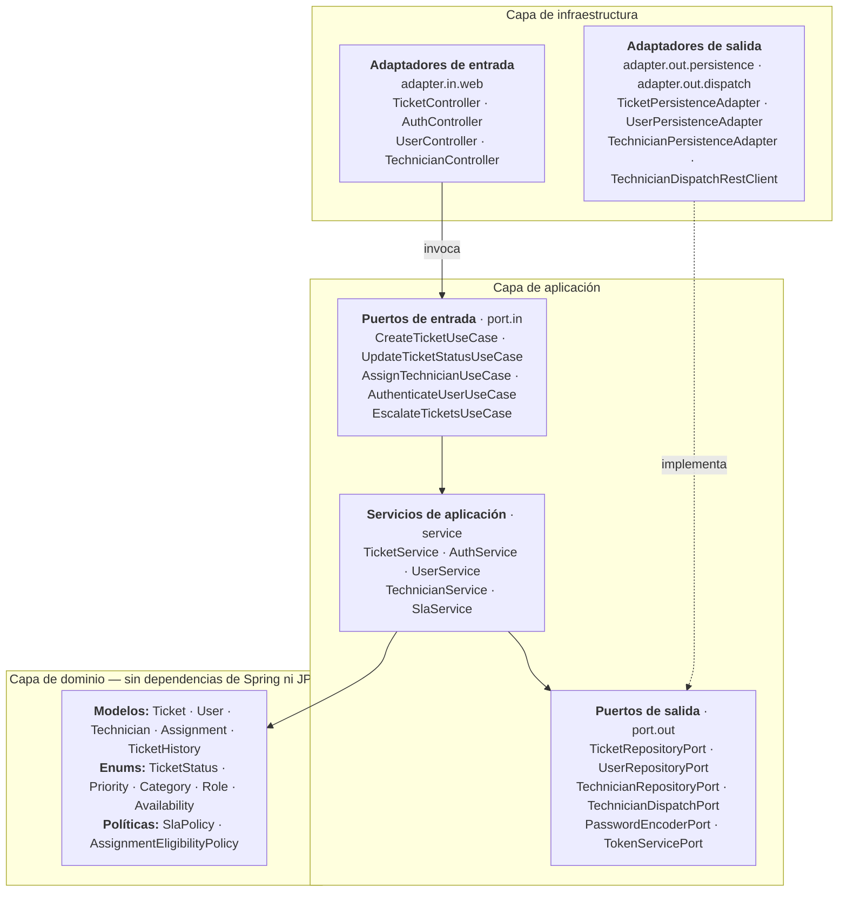
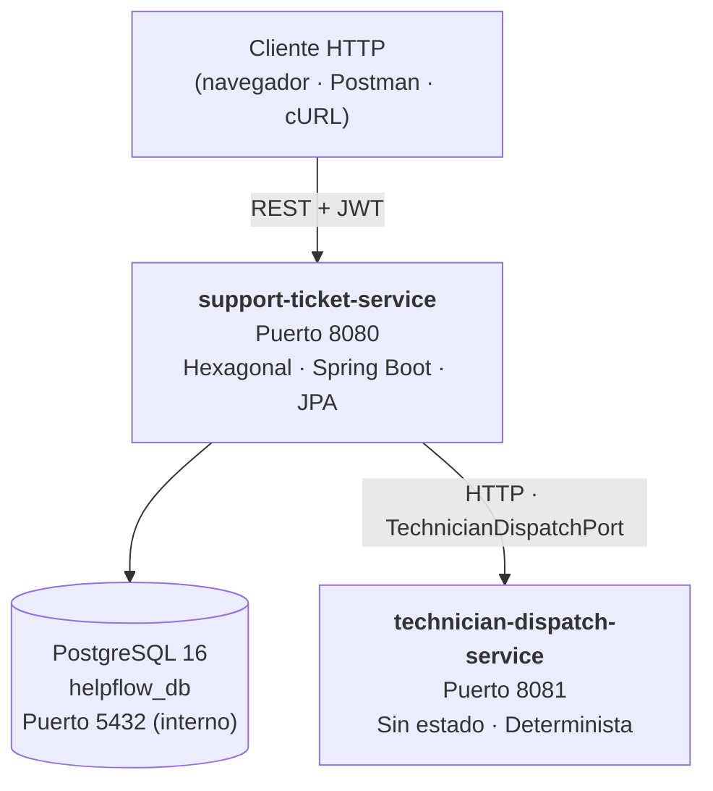
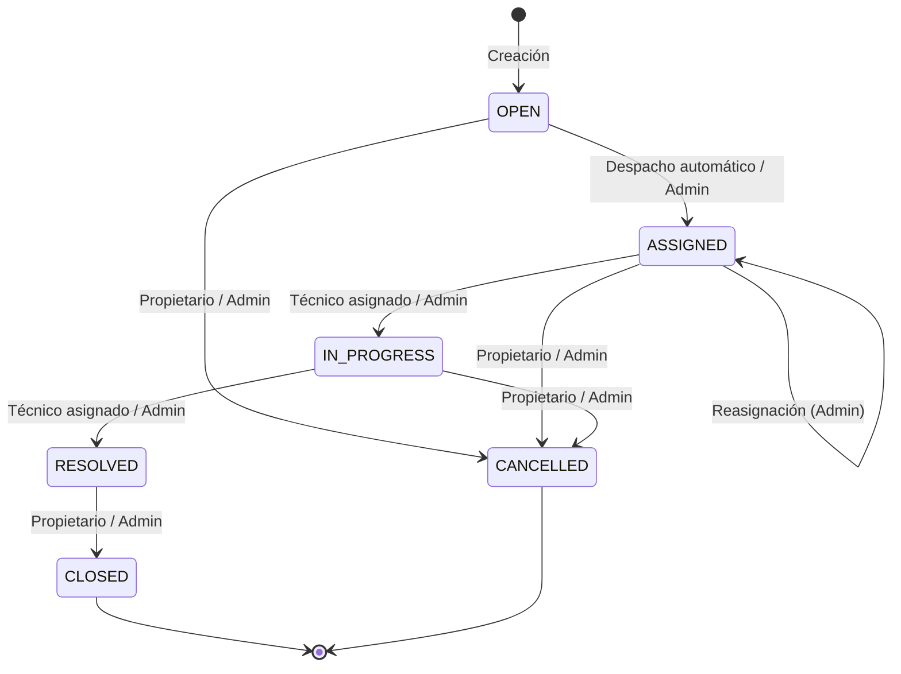
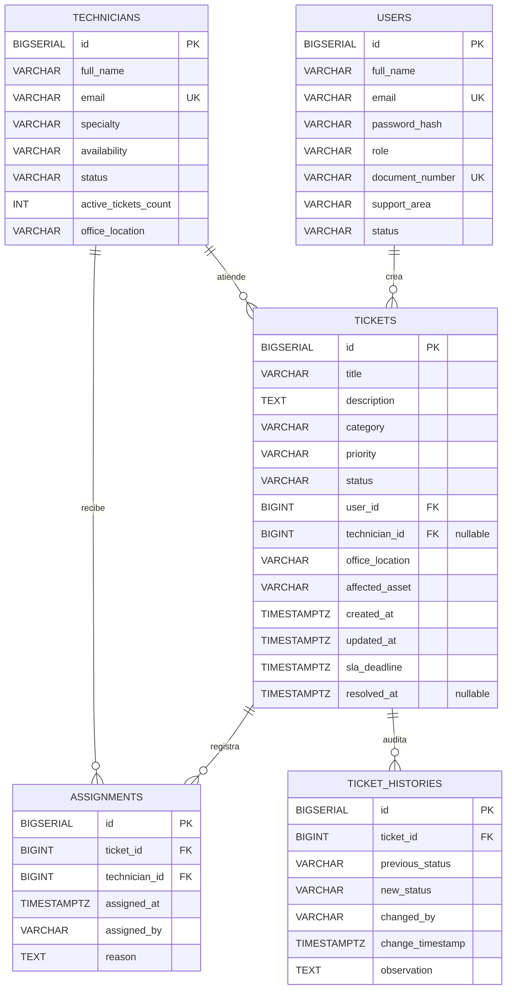

# HelpFlow — Sistema de Gestión de Tickets de Soporte TI

[](https://openjdk.org/)
[](https://spring.io/projects/spring-boot)
[]()
[](https://www.postgresql.org/)
[](https://www.docker.com/)
[]()
[]()

**HelpFlow** es una plataforma distribuida para la gestión de incidencias de soporte TI. Está construida siguiendo los principios de **Arquitectura Hexagonal (Puertos y Adaptadores)** y **Diseño Guiado por el Dominio (DDD)**, y se compone de dos microservicios independientes.

### Funcionalidades principales

- Registro y seguimiento de incidencias con ciclo de vida controlado por una máquina de estados.
- Cálculo automático de plazos de SLA según la prioridad del ticket.
- Asignación determinista de técnicos mediante un microservicio de despacho, con mecanismo de respaldo local.
- Escalamiento automático de tickets en riesgo de incumplir su SLA.
- Autenticación JWT sin estado y control de acceso basado en roles (RBAC).
- Observabilidad mediante logs estructurados con trazabilidad y métricas de Micrometer.

---

> [!TIP]
> ### 🔑 Credenciales de Acceso y Datos de Prueba Iniciales
> El sistema se inicializa automáticamente mediante las migraciones de Flyway (`V3__initial_data.sql`) con los siguientes usuarios predeterminados para pruebas inmediatas en **Swagger UI** o **Postman**:
>
> | Rol | Correo exacto | Contraseña | Perfil / Permisos | Variable Postman |
> | :--- | :--- | :--- | :--- | :--- |
> | **Administrador** | `admin@helpflow.com` | `Password123!` | Acceso total, reasignaciones y supervisión global | `{{adminToken}}` |
> | **Usuario** | `usuario@helpflow.com` | `Password123!` | Solicitante (crea y cierra sus propios tickets) | `{{userToken}}` |
> | **Técnico** | `tecnico@helpflow.com` | `Password123!` | Soporte técnico (atiende tickets asignados a él) | `{{techToken}}` |
>
> *Al iniciar sesión en Postman con cualquiera de estos usuarios, los scripts de prueba capturan y configuran automáticamente el token correspondiente.*

---

## Tabla de contenidos

1. [Arquitectura](#1-arquitectura)
2. [Microservicios](#2-microservicios)
3. [Ciclo de vida del ticket](#3-ciclo-de-vida-del-ticket)
4. [Gestión de SLA y escalamiento](#4-gestión-de-sla-y-escalamiento)
5. [Modelo de datos y migraciones](#5-modelo-de-datos-y-migraciones)
6. [Referencia de la API](#6-referencia-de-la-api)
7. [Seguridad y autenticación](#7-seguridad-y-autenticación)
8. [Observabilidad y métricas](#8-observabilidad-y-métricas)
9. [Requisitos e instalación](#9-requisitos-e-instalación)
10. [Despliegue con Docker Compose](#10-despliegue-con-docker-compose)
11. [Pruebas y calidad](#11-pruebas-y-calidad)
12. [Colección de Postman](#12-colección-de-postman)
13. [Evidencia de ejecución](#13-evidencia-de-ejecución)

---

## 1. Arquitectura

El servicio principal implementa **Arquitectura Hexagonal**: la lógica de negocio está completamente aislada de los frameworks, la tecnología de persistencia y los protocolos de comunicación. Las dependencias siempre apuntan hacia el dominio.



### Estructura de paquetes

```text
support-ticket-service/src/main/java/com/helpflow/ticket/
├── domain/                        # Lógica de negocio pura (sin Spring ni JPA)
│   ├── model/                     # Ticket, User, Technician, Assignment, TicketHistory
│   ├── policy/                    # SlaPolicy, AssignmentEligibilityPolicy
│   └── exception/                 # DomainRuleViolationException, InvalidTransitionException, …
├── application/                   # Orquestación y casos de uso
│   ├── port/in/                   # Interfaces de los puertos de entrada
│   ├── port/out/                  # Interfaces de los puertos de salida
│   └── service/                   # Implementaciones de los casos de uso
└── infrastructure/                # Implementaciones técnicas
    ├── adapter/in/web/            # Controladores REST, DTOs, GlobalExceptionHandler
    ├── adapter/out/persistence/   # Entidades JPA, repositorios Spring Data, mappers
    ├── adapter/out/dispatch/      # Cliente REST hacia el servicio de despacho
    ├── security/                  # Spring Security 6, JwtAuthenticationFilter, TokenProvider
    ├── metrics/                   # Configuración y registro de métricas Micrometer
    ├── scheduler/                 # Tarea programada de escalamiento por SLA
    └── config/                    # Configuración de beans, Clock y OpenAPI
```

---

## 2. Microservicios

El sistema está compuesto por dos microservicios que se ejecutan como procesos independientes.



### `support-ticket-service` (puerto 8080)

- Gestiona usuarios, autenticación corporativa, ciclo de vida de los tickets, catálogo de técnicos y auditoría.
- Persistencia en PostgreSQL con Spring Data JPA y migraciones versionadas con Flyway.
- Protege las rutas mediante autenticación JWT sin estado y control de acceso por roles.
- Invoca automáticamente al servicio de despacho al crear un ticket.
- Ejecuta cada 60 segundos una tarea que detecta tickets próximos a incumplir su SLA y eleva su prioridad.

### `technician-dispatch-service` (puerto 8081)

- Microservicio autónomo que simula la asignación de técnicos.
- No depende de base de datos ni de filtros de seguridad.
- Expone el endpoint `POST /technician-dispatch`.
- **Selección determinista:** calcula un hash MD5 a partir de `ticketId`, `category` y `priority`, módulo 20. La misma entrada produce siempre el mismo técnico y la misma disponibilidad.
- Clasificación de disponibilidad:

  | Tiempo estimado | Disponibilidad |
  | :--- | :--- |
  | 0 – 2 horas | `HIGH` |
  | 3 – 8 horas | `MEDIUM` |
  | Más de 8 horas | `LOW` |

- **Tolerancia a fallos:** si el servicio de despacho no responde o devuelve un error, `support-ticket-service` recurre a la política de elegibilidad local y registra la asignación como de respaldo, sin interrumpir la creación del ticket.

---

## 3. Ciclo de vida del ticket

La máquina de estados se aplica en la capa de dominio (`Ticket.java`). Cualquier transición no permitida se rechaza con **HTTP 400 Bad Request**.



### Transiciones permitidas y reglas de negocio

| Estado origen | Estado destino | Rol requerido | Observación obligatoria | Efectos y reglas de dominio |
| :--- | :--- | :--- | :--- | :--- |
| — | `OPEN` | `ROLE_USUARIO`, `ROLE_ADMIN` | No | El usuario debe estar activo. Se calcula el plazo de SLA según la prioridad y se solicita un técnico. |
| `OPEN` | `ASSIGNED` | Sistema, `ROLE_ADMIN` | Motivo, en caso de reasignación | El técnico debe estar `ACTIVE` y tener la especialidad correspondiente. Se incrementa su contador de tickets activos. |
| `ASSIGNED` | `ASSIGNED` | `ROLE_ADMIN` | Motivo de reasignación | Se decrementa el contador del técnico anterior, se incrementa el del nuevo y se actualiza el registro de asignación. |
| `ASSIGNED` | `IN_PROGRESS` | `ROLE_TECNICO` (asignado), `ROLE_ADMIN` | Sí | Solo el técnico asignado puede iniciar la atención. |
| `IN_PROGRESS` | `RESOLVED` | `ROLE_TECNICO` (asignado), `ROLE_ADMIN` | Notas de resolución | Se registra la fecha de resolución y se decrementa el contador del técnico. |
| `RESOLVED` | `CLOSED` | `ROLE_USUARIO` (propietario), `ROLE_ADMIN` | Comentario de cierre | Estado final. No admite más transiciones. |
| `OPEN` / `ASSIGNED` / `IN_PROGRESS` | `CANCELLED` | `ROLE_USUARIO` (propietario), `ROLE_ADMIN` | Motivo de cancelación | Estado final. Si había técnico asignado, se decrementa su contador. |

---

## 4. Gestión de SLA y escalamiento

El plazo de SLA se calcula al crear el ticket mediante `SlaPolicy`, que recibe un `Clock` inyectable para facilitar las pruebas.

| Prioridad | Plazo de resolución | Regla de escalamiento automático |
| :--- | :--- | :--- |
| `CRITICAL` | 4 horas | Ya es la prioridad máxima; solo se registra una alerta. |
| `HIGH` | 8 horas | A menos de 2 horas del vencimiento → `CRITICAL` |
| `MEDIUM` | 24 horas | A menos de 4 horas del vencimiento → `HIGH` |
| `LOW` | 48 horas | A menos de 8 horas del vencimiento → `MEDIUM` |

### Tarea de escalamiento

Implementada en `SlaEscalationScheduler.java`:

1. Se ejecuta periódicamente con `@Scheduled(cron = "${helpflow.sla.escalation-cron:0 * * * * *}")` (cada 60 segundos por defecto).
2. Consulta los tickets activos (`OPEN`, `ASSIGNED`, `IN_PROGRESS`).
3. Evalúa cada uno con `slaPolicy.shouldEscalate(ticket, now)`.
4. Si corresponde, eleva la prioridad, recalcula el plazo de SLA, registra una entrada en `TicketHistory` con `actor = SYSTEM` y persiste los cambios en una transacción.
5. Si el plazo ya venció, incrementa la métrica `helpflow.tickets.overdue`.

---

## 5. Modelo de datos y migraciones

El esquema se versiona con Flyway en `support-ticket-service/src/main/resources/db/migration/`:

| Migración | Contenido |
| :--- | :--- |
| `V1__schema.sql` | Tablas `users`, `technicians` y `tickets`. |
| `V2__assignments_history_sla.sql` | Tablas `assignments` y `ticket_histories`, índices y claves foráneas. |
| `V3__initial_data.sql` | Datos iniciales: 20 técnicos y usuarios de prueba (administrador, usuario y técnico). |

### Diagrama entidad-relación



### Prevención de consultas N+1

- Los métodos de consulta de `SpringDataTicketRepository` usan `@EntityGraph(attributePaths = {"user", "technician"})` y consultas con `JOIN FETCH`.
- Las colecciones de `TicketJpaEntity` se modelan como `Set` (`LinkedHashSet`) para evitar `MultipleBagFetchException`.

---

## 6. Referencia de la API

Todos los endpoints, excepto `/auth/**`, la documentación OpenAPI y Actuator, requieren un token JWT en la cabecera:

```http
Authorization: Bearer <token>
```

La documentación interactiva está disponible en Swagger UI: `http://localhost:8080/swagger-ui/index.html`.

### Autenticación

| Método | Endpoint | Acceso | Descripción |
| :--- | :--- | :--- | :--- |
| `POST` | `/auth/register` | Público | Registra un usuario con rol `ROLE_USUARIO`. Exige un correo corporativo `@helpflow.com`. |
| `POST` | `/auth/login` | Público | Autentica al usuario y devuelve un token JWT. |

### Usuarios

| Método | Endpoint | Acceso | Descripción |
| :--- | :--- | :--- | :--- |
| `GET` | `/users/me` | Autenticado | Consulta el perfil del usuario autenticado. |
| `PUT` | `/users/me` | Autenticado | Actualiza el nombre completo y el área de soporte. |
| `GET` | `/users` | `ROLE_ADMIN` | Lista los usuarios, con filtro opcional por estado. |
| `PATCH` | `/users/{id}/status` | `ROLE_ADMIN` | Activa o desactiva una cuenta. |

### Técnicos

| Método | Endpoint | Acceso | Descripción |
| :--- | :--- | :--- | :--- |
| `GET` | `/technicians` | Autenticado | Lista técnicos, con filtros opcionales `?specialty=` y `?availability=`. |
| `GET` | `/technicians/{id}` | Autenticado | Consulta el detalle de un técnico. |
| `PATCH` | `/technicians/{id}/availability` | `ROLE_ADMIN` | Actualiza la disponibilidad de un técnico. |

### Tickets

| Método | Endpoint | Acceso | Descripción |
| :--- | :--- | :--- | :--- |
| `POST` | `/tickets` | `ROLE_USUARIO`, `ROLE_ADMIN` | Crea un ticket; calcula el SLA y solicita la asignación automática. |
| `GET` | `/tickets` | `ROLE_ADMIN` | Lista todos los tickets, con filtros por `status`, `priority`, `category` y `overdue`. |
| `GET` | `/tickets/my` | `ROLE_USUARIO`, `ROLE_TECNICO` | Lista los tickets creados por el usuario o asignados al técnico. |
| `GET` | `/tickets/{id}` | Autenticado | Consulta un ticket; se valida la pertenencia para usuarios y técnicos. |
| `POST` | `/tickets/{id}/assign` | `ROLE_ADMIN` | Asigna o reasigna un ticket a un técnico. |
| `PATCH` | `/tickets/{id}/status` | Autenticado | Cambia el estado (`IN_PROGRESS`, `RESOLVED`, `CLOSED`, `CANCELLED`). |

### Servicio de despacho

| Método | Endpoint | Acceso | Descripción |
| :--- | :--- | :--- | :--- |
| `POST` | `/technician-dispatch` | Público (puerto 8081) | Algoritmo determinista de selección de técnico. |

### Formato de errores (RFC 7807)

Todos los errores se devuelven como `ProblemDetail` según el estándar RFC 7807, e incluyen el identificador de traza de la petición:

```json
{
  "type": "about:blank",
  "title": "Invalid Ticket Transition",
  "status": 400,
  "detail": "Cannot transition ticket 1 from status CLOSED to OPEN. Permitted target states: none",
  "instance": "/tickets/1/status",
  "timestamp": "2026-10-27T14:48:30.125Z",
  "traceId": "9b642ca8-3162-43bb-a5eb-06fceeb0ea12"
}
```

---

## 7. Seguridad y autenticación

| Aspecto | Implementación |
| :--- | :--- |
| Firma de tokens | HMAC-SHA256 con `jjwt-api` / `jjwt-impl` 0.12.6. |
| Sesión | Sin estado (`SessionCreationPolicy.STATELESS`). |
| Contraseñas | Cifradas con BCrypt (factor de coste 10). |
| Registro | Restringido a correos corporativos `*@helpflow.com`. |
| Identidad | Se obtiene exclusivamente del `SecurityContextHolder`, lo que impide la suplantación por ID. |
| Pertenencia de recursos | Los usuarios solo acceden a sus propios tickets; los técnicos, solo a los que tienen asignados. Los administradores tienen acceso total. |

### Cuentas de prueba

Disponibles tras ejecutar las migraciones. **Solo para entornos de desarrollo.**

| Rol | Correo | Contraseña | Perfil | Variable Postman |
| :--- | :--- | :--- | :--- | :--- |
| `ROLE_ADMIN` | `admin@helpflow.com` | `Password123!` | Administrador del sistema | `{{adminToken}}` |
| `ROLE_TECNICO` | `tecnico@helpflow.com` | `Password123!` | Especialista en soporte de hardware | `{{techToken}}` |
| `ROLE_USUARIO` | `usuario@helpflow.com` | `Password123!` | Usuario del área de Finanzas | `{{userToken}}` |

---

## 8. Observabilidad y métricas

### Identificador de traza

Cada petición HTTP pasa por `TraceIdFilter`. Si llega la cabecera `X-Trace-Id`, se reutiliza; de lo contrario, se genera un UUID. El identificador se guarda en el `MDC` de SLF4J, se devuelve en la cabecera `X-Trace-Id` de la respuesta y se incluye en todos los logs:

```text
2026-10-27T14:48:30.125Z [9b642ca8-3162-43bb-a5eb-06fceeb0ea12] INFO  c.h.t.a.s.TicketService : Ticket created with id: 1, SLA deadline: 2026-10-27T22:48:30.125Z
```

### Métricas de Micrometer

Disponibles en `/actuator/metrics`:

| Métrica | Tipo | Descripción |
| :--- | :--- | :--- |
| `helpflow.tickets.created` | Contador | Tickets creados, etiquetados por `priority` y `category`. |
| `helpflow.tickets.overdue` | Contador | Tickets que superaron su plazo de SLA. |
| `helpflow.tickets.first_response.time` | Temporizador | Tiempo entre la creación del ticket y su asignación. |
| `helpflow.tickets.resolution.time` | Temporizador | Tiempo total entre la creación y la resolución. |
| `helpflow.auth.failures` | Contador | Intentos de inicio de sesión fallidos. |
| `helpflow.auth.access_denied` | Contador | Accesos denegados (HTTP 403). |

---

## 9. Requisitos e instalación

### Requisitos

| Herramienta | Versión |
| :--- | :--- |
| JDK | 21 (se recomienda Eclipse Temurin) |
| Maven | 3.8 o superior |
| Docker / Docker Compose | Docker 24+ y Compose v2+ |
| PostgreSQL *(opcional, ejecución local)* | 15 o superior |

### Ejecución local con Maven

**1. Levantar PostgreSQL** (localmente o con Docker):

```bash
docker run --name helpflow-postgres \
  -e POSTGRES_DB=helpflow_db \
  -e POSTGRES_USER=helpflow_user \
  -e POSTGRES_PASSWORD=helpflow_password \
  -p 5432:5432 -d postgres:16-alpine
```

**2. Compilar el proyecto multimódulo:**

```bash
mvn clean package
```

**3. Iniciar el servicio de despacho** (puerto 8081):

```bash
mvn spring-boot:run -pl technician-dispatch-service
```

**4. Iniciar el servicio de tickets** (puerto 8080), en otra terminal:

```bash
mvn spring-boot:run -pl support-ticket-service
```

**5. Abrir Swagger UI:** `http://localhost:8080/swagger-ui/index.html`

---

## 10. Despliegue con Docker Compose

El archivo `docker-compose.yml` orquesta los tres contenedores del sistema.

```bash
# Construir e iniciar todos los contenedores en segundo plano
docker compose up --build -d
```

### Verificar el estado

```bash
docker compose ps
```

| Contenedor | Verificación de salud |
| :--- | :--- |
| `helpflow-postgres` | `pg_isready -U helpflow_user -d helpflow_db` |
| `technician-dispatch-service` | `/actuator/health` en el puerto 8081 |
| `support-ticket-service` | `/actuator/health` en el puerto 8080; espera a que PostgreSQL y el servicio de despacho estén saludables. |

### Consultar logs

```bash
docker compose logs -f support-ticket-service
```

### Detener el sistema

```bash
docker compose down -v
```

> **Nota:** la opción `-v` elimina también los volúmenes, por lo que se perderán los datos de la base de datos.

---

## 11. Pruebas y calidad

La suite automatizada cubre el dominio, las transiciones de la máquina de estados, casos límite, políticas de seguridad y flujos completos de integración. Las pruebas de integración se ejecutan contra una base de datos PostgreSQL real mediante **Testcontainers**, sin mocks de la capa de persistencia.

### Ejecutar las pruebas

```bash
mvn test
```

### Resultado

| Módulo | Clase de prueba |
| :--- | :--- |
| `technician-dispatch-service` | `TechnicianDispatchApplicationTests` |
| | `TechnicianDispatchControllerTest` |
| | `TechnicianDispatchServiceTest` |
| `support-ticket-service` | `SupportTicketServiceApplicationTests` |
| | `TicketStateMachineTest` |
| | `SlaPolicyTest` |
| | `AuthControllerIntegrationTest` |
| | `FullLifecycleIntegrationTest` |
| | `TicketSecurityIntegrationTest` |

```text
Tests run: 75, Failures: 0, Errors: 0, Skipped: 0
```

### Cobertura de código (JaCoCo)

| Módulo | Líneas | Ramas | Métodos | Clases |
| :--- | :---: | :---: | :---: | :---: |
| `support-ticket-service` | 81,7 % | 62,5 % | 83,8 % | 97,7 % |
| `technician-dispatch-service` | 81,7 % | 91,7 % | 87,5 % | 100,0 % |
| **Umbral mínimo** | ≥ 80 % | ≥ 60 % | ≥ 80 % | ≥ 90 % |

---

## 12. Colección de Postman

En la raíz del proyecto se incluye la colección [`HelpFlow_API.postman_collection.json`](./HelpFlow_API.postman_collection.json).

1. En Postman, selecciona **Import** y elige el archivo `HelpFlow_API.postman_collection.json`.
2. La colección trae configuradas las variables `baseUrl` (`http://localhost:8080`) y `dispatchUrl` (`http://localhost:8081`).
3. Ejecuta primero la petición **Login Admin**: su script guarda automáticamente el JWT en `{{adminToken}}` y `{{token}}`.
4. Las peticiones de las carpetas *User Management*, *Technician Management* y *Ticket Lifecycle* usan ese token y actualizan variables como `{{ticketId}}` y `{{userId}}` a medida que se ejecutan.

---

## 13. Evidencia de ejecución

- **Migraciones:** Flyway aplica correctamente `V1__schema.sql`, `V2__assignments_history_sla.sql` y `V3__initial_data.sql` al iniciar el contenedor.
- **Datos iniciales:** se cargan 20 técnicos distribuidos en las especialidades `HARDWARE`, `SOFTWARE`, `NETWORK`, `SECURITY` y `DATABASE`.
- **Asignación automática:** al crear un ticket, `TechnicianDispatchRestClientAdapter` consulta el servicio de despacho de forma síncrona, asigna un técnico compatible y el ticket pasa a `ASSIGNED` con su registro inicial de auditoría.
- **Trazabilidad:** los errores RFC 7807 y todos los logs incluyen el `traceId` de la petición.
- **Pruebas sin mocks de persistencia:** todas las pruebas de integración se ejecutan contra instancias reales de PostgreSQL mediante Testcontainers.